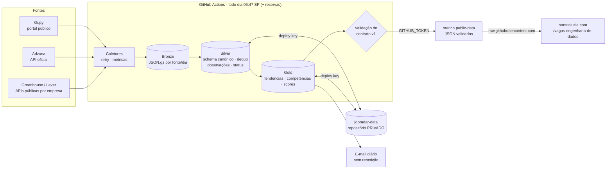

# 📡 JobRadar

**Observatório de vagas e competências em Engenharia de Dados**

Pipeline de dados que roda sozinho todos os dias: coleta vagas de Engenharia de Dados no Brasil, guarda o histórico em arquitetura **Medallion** (Bronze → Silver → Gold), identifica as competências que cada vaga pede, publica os dados abertos e manda um e-mail com as vagas novas.

- **Vagas ao vivo:** [santosluzia.com/vagas-engenharia-de-dados](https://santosluzia.com/vagas-engenharia-de-dados), a tela pública do portfólio, feita para o celular e instalável na Tela de Início do iPhone
- **Código:** [github.com/santosluzia/JobRadar](https://github.com/santosluzia/JobRadar)
- **Dados abertos (contrato v1):** [`public-data/v1/`](https://github.com/santosluzia/JobRadar/tree/public-data/v1), com [`jobs.json`](https://raw.githubusercontent.com/santosluzia/jobradar/refs/heads/public-data/v1/jobs.json) e [`manifest.json`](https://raw.githubusercontent.com/santosluzia/jobradar/refs/heads/public-data/v1/manifest.json)

> Projeto pessoal e de portfólio de Luzia Santos. Não automatiza candidaturas: entrega o link da vaga original para a candidatura manual.

---

## O problema

Quem está migrando para Engenharia de Dados precisa responder, com dados e não com achismo:

- quais vagas abriram hoje e valem a candidatura;
- quais competências aparecem com mais frequência nas vagas júnior e pleno, e como isso muda ao longo dos meses;
- onde estão as lacunas do próprio perfil e o que estudar primeiro.

## Como funciona

Tudo acontece no **GitHub Actions**, uma vez por dia, sem servidor e sem custo. O portfólio não executa nada: ele só lê os arquivos JSON que o pipeline publica.

1. **Agendamento.** O workflow [`Pipeline diário`](.github/workflows/daily-pipeline.yml) roda às **06:47 (horário de São Paulo)**. O GitHub não garante o horário das execuções agendadas: elas podem atrasar horas ou nem acontecer. Por isso há reservas às 09:17 e às 12:37. Um job de checagem deixa rodar só a primeira execução que der certo no dia, então as reservas não coletam de novo nem repetem o e-mail.
2. **Coleta.** Os coletores consultam quatro fontes, com timeout, retry e métricas por fonte:
   - **Gupy**, pelo endpoint do portal público;
   - **Adzuna**, pela API oficial;
   - **Greenhouse**, pelas APIs públicas de 12 empresas brasileiras;
   - **Lever**, pela API pública da CI&T.

   Os termos de busca e as empresas ficam em [`config/sources.yaml`](config/sources.yaml).
3. **Bronze.** A resposta bruta de cada fonte é guardada como está (JSON compactado por fonte e dia), para poder reprocessar.
4. **Silver.** As vagas viram um schema canônico validado com Pydantic. Nesta camada o pipeline:
   - remove duplicatas por id, URL canônica e chave alternativa entre fontes;
   - registra cada observação e as mudanças de requisitos;
   - classifica a situação de cada vaga como ativa, desconhecida ou encerrada.
5. **Competências e aderência.** Regras configuráveis ([`config/skills.yaml`](config/skills.yaml)) extraem as competências e as separam em requisito ou desejável. Também inferem senioridade e modalidade. Um score explicável compara cada vaga com o perfil privado.
6. **Gold.** Ficam aqui os agregados para análise: tendências mensais, competências mais pedidas, distribuição por modalidade e senioridade, e os scores.
7. **Histórico privado.** Bronze, Silver, Gold, o perfil e o registro de e-mails enviados são gravados no repositório **privado** `jobradar-data`, com uma deploy key de acesso restrito.
8. **Dados públicos.** `jobradar publish` gera o contrato v1 (`jobs.json`, `market-summary.json`, `skill-trends.json`, `manifest.json`) e valida cada arquivo com JSON Schema antes de publicar na branch `public-data`. Se a validação falhar, o site continua com a última versão válida. Score e perfil **não** entram nos dados públicos.
9. **E-mail diário.** Leva as vagas relevantes publicadas ontem e hoje, no mesmo visual do portfólio. As 10 de maior aderência vêm em cartões e o restante numa lista compacta, todas com o link "Abrir vaga para se candidatar". Cada vaga é enviada uma única vez, mesmo que o workflow seja reexecutado.
10. **Portfólio.** A rota [`/vagas-engenharia-de-dados`](https://santosluzia.com/vagas-engenharia-de-dados) lê o `jobs.json` direto do `raw.githubusercontent.com`, sem token e sem backend. A tela tem:
    - as vagas das mais recentes para as mais antigas, com abas por fonte;
    - filtros de período, empresa, local, modalidade, senioridade e busca;
    - uma visão de gráficos.



### Onde cada peça vive

| Peça | Visibilidade | Responsabilidade |
|---|---|---|
| [`santosluzia/JobRadar`](https://github.com/santosluzia/JobRadar) | pública | Código, testes, documentação, contrato de dados e o workflow diário |
| `santosluzia/jobradar-data` | **privada** | Histórico durável (Parquet), perfil, candidaturas e registro de notificações |
| branch [`public-data`](https://github.com/santosluzia/JobRadar/tree/public-data) | pública | Somente os JSON agregados e validados (`v1/`) |
| [santosluzia.com](https://santosluzia.com/vagas-engenharia-de-dados) | pública | Portfólio: a rota `/vagas-engenharia-de-dados` lê o contrato; não executa Python nem acessa credenciais |

Detalhes e decisões em [`docs/architecture.md`](docs/architecture.md). O modelo de dados está em [`docs/data-dictionary.md`](docs/data-dictionary.md), o contrato público em [`docs/contracts/`](docs/contracts/README.md) e a operação (secrets, agendamento, diagnóstico) em [`docs/operations.md`](docs/operations.md).

## Funcionalidades

| Funcionalidade | Situação |
|---|---|
| Coleta Gupy (endpoint do portal público, sem login) | ✅ não é API oficial, ver limitações |
| Coleta Adzuna (API oficial) | ✅ depende de `ADZUNA_APP_ID`/`ADZUNA_APP_KEY` |
| Coleta Greenhouse (12 empresas) e Lever (CI&T), com filtro por título | ✅ |
| Bronze / Silver / Gold incrementais em Parquet + DuckDB | ✅ |
| Deduplicação por id, URL canônica e chave alternativa entre fontes | ✅ |
| Histórico de observações e mudanças de requisitos | ✅ |
| Status ativa / desconhecida / encerrada com regra documentada | ✅ |
| Extração de competências (requisito × desejável) | ✅ heurística configurável |
| Score de aderência explicável e recomendações de estudo | ✅ privados |
| Contrato público v1 validado (JSON Schema) | ✅ |
| Execução diária com reservas e sem duplicar | ✅ 06:47, 09:17 e 12:37 (SP) |
| E-mail HTML diário sem repetição, no visual do portfólio | ✅ vagas de ontem e hoje + encontradas atrasadas; 10 cartões e lista compacta |
| Tela pública de vagas no portfólio | ✅ [santosluzia.com/vagas-engenharia-de-dados](https://santosluzia.com/vagas-engenharia-de-dados) |
| Candidaturas e progresso de estudos (privado) | ✅ CLI |

## Executar localmente

Pré-requisitos: Python 3.11+ e Git.

```bash
git clone https://github.com/santosluzia/JobRadar.git jobradar
git clone git@github.com:santosluzia/jobradar-data.git   # privado: o histórico
cd jobradar
python -m venv .venv && source .venv/bin/activate          # Windows: .venv\Scripts\activate
pip install -e ".[app,dev]"
cp .env.example .env                                       # JOBRADAR_LAKE=../jobradar-data

cp config/profile.example.yaml ../jobradar-data/private/profile.yaml   # preencha seu perfil

pytest -q                                   # 66 testes, sem acesso à internet
jobradar run                                # coleta + bronze/silver/gold
jobradar publish --out public_out           # gera e valida o contrato v1
jobradar notify --dry-run                   # prévia do e-mail em jobradar-email.html
jobradar recomendacoes                      # prioridades de estudo
```

Para rodar a coleta na nuvem fora do horário, use **Actions → Pipeline diário → Run workflow**. A execução manual sempre roda, e o campo "Enviar e-mail" escolhe se manda o e-mail.

Registrar candidaturas e estudos (ficam em `jobradar-data/private/`):

```bash
jobradar candidatura <job_id> candidatado --nota "currículo v3"
jobradar estudo databricks em_andamento --inicio 2026-10-01
```

## Configuração

| Arquivo | O que controla |
|---|---|
| `config/sources.yaml` | Termos de busca, fontes ligadas, filtros de relevância, e-mail e retenção |
| `config/skills.yaml` | Taxonomia de competências, padrões de extração, esforço estimado |
| `config/scoring.yaml` | Pesos do score de aderência e regras das recomendações |
| `<lake>/private/profile.yaml` | Seu perfil (privado). Modelo: `config/profile.example.yaml` |

Variáveis de ambiente: veja [`.env.example`](.env.example). O setup do GitHub (repositórios, deploy key e secrets) está em [`docs/operations.md`](docs/operations.md).

## Limitações metodológicas

- **A amostra não é o mercado.** Os números refletem as fontes e os termos configurados. Mudanças de fonte ou de volume alteram proporções; por isso toda análise mostra o `n` e sinaliza amostras pequenas.
- **Extração por regras.** Competências e senioridade vêm de padrões de texto. A separação requisito/desejável é heurística.
- **Status de vaga.** Sumir de uma coleta não encerra a vaga: ela vira "desconhecida" depois de 14 dias sem observação. Só é "encerrada" com evidência (prazo vencido informado pela fonte).
- **Score não é probabilidade.** Ele mede compatibilidade com o perfil declarado. "Sem evidência" significa que a competência não está registrada no perfil, não que a pessoa não a tenha.
- **Gupy.** O endpoint usado pelo portal público não é uma API documentada. Pode mudar sem aviso; o coletor detecta mudança de formato e a execução registra a falha.
- **Horário do GitHub.** As execuções agendadas podem atrasar; as reservas cobrem o dia, mas o e-mail pode chegar depois das 06:47.
- **Correlação ≠ causalidade.** Tendências descrevem a amostra coletada; não explicam por que a demanda mudou.

## Stack

Python · httpx · Pydantic · DuckDB · Parquet/PyArrow · pandas · jsonschema · pytest · GitHub Actions · TanStack Start + React (portfólio)
