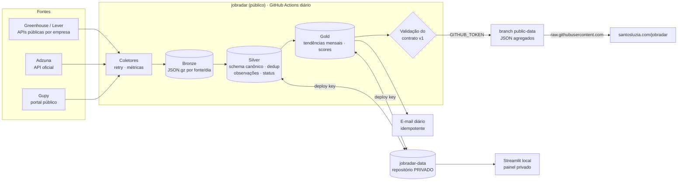

# 📡 JobRadar

**Observatório de Mercado e Inteligência de Carreira em Engenharia de Dados**

Pipeline de dados que coleta vagas diariamente, mantém o histórico em arquitetura **Medallion** (Bronze → Silver → Gold), identifica as competências que o mercado pede, compara com um perfil profissional e recomenda prioridades de estudo de forma explicável. Os indicadores públicos alimentam o dashboard do portfólio em [santosluzia.com](https://santosluzia.com/).

> Projeto pessoal e de portfólio de Luzia Santos. Não automatiza candidaturas: entrega links para candidatura manual.

---

## O problema

Quem está migrando para Engenharia de Dados precisa responder, com dados e não com achismo:

- quais vagas abriram hoje e valem a candidatura;
- quais competências aparecem com mais frequência nas vagas júnior e pleno, e como isso muda ao longo dos meses;
- onde estão as lacunas do próprio perfil e o que estudar primeiro.

## Arquitetura



| Peça | Onde | Responsabilidade |
|---|---|---|
| `santosluzia/jobradar` | público | Código, testes, documentação e contrato de dados |
| `santosluzia/jobradar-data` | **privado** | Histórico durável (Parquet), perfil, candidaturas, registro de notificações |
| branch `public-data` | pública | Somente os JSON agregados e validados (`v1/`) |
| `ailumtech/santos-luzia` | portfólio | Rota `/jobradar` que lê o contrato; não executa Python nem acessa credenciais |

Detalhes e decisões em [`docs/architecture.md`](docs/architecture.md). O modelo de dados está em [`docs/data-dictionary.md`](docs/data-dictionary.md) e o contrato público em [`docs/contracts/`](docs/contracts/README.md).

## Funcionalidades

| Funcionalidade | Situação |
|---|---|
| Coleta Gupy (endpoint do portal público, sem login) | ✅ implementada; não é API oficial, ver limitações |
| Coleta Adzuna (API oficial) | ✅ implementada; depende de `ADZUNA_APP_ID`/`ADZUNA_APP_KEY` e da cobertura BR |
| Coleta Greenhouse / Lever (APIs públicas por empresa) | ✅ ativa com 13 empresas brasileiras e filtro por título |
| Bronze / Silver / Gold incrementais em Parquet + DuckDB | ✅ |
| Deduplicação por id, URL canônica e chave alternativa entre fontes | ✅ |
| Histórico de observações e mudanças de requisitos | ✅ |
| Status ativa / desconhecida / encerrada com regra documentada | ✅ |
| Extração de competências (requisito × desejável) | ✅ heurística configurável |
| Score de aderência explicável | ✅ |
| Recomendações de estudo com regras de confiança | ✅ |
| Contrato público v1 validado (JSON Schema) | ✅ |
| E-mail HTML diário sem repetição | ✅ depende dos secrets SMTP |
| Candidaturas e progresso de estudos (privado) | ✅ CLI; páginas do painel fora do menu por enquanto |
| Painel Streamlit privado (Visão geral e Mercado) | ✅ roda localmente |
| Dashboard público no portfólio | ✅ rota `/jobradar` entregue como PR separado |

## Executar localmente

Pré-requisitos: Python 3.11+ e Git.

```bash
git clone https://github.com/santosluzia/jobradar.git
git clone git@github.com:santosluzia/jobradar-data.git   # privado: o histórico
cd jobradar
python -m venv .venv && source .venv/bin/activate          # Windows: .venv\Scripts\activate
pip install -e ".[app,dev]"
cp .env.example .env                                       # JOBRADAR_LAKE=../jobradar-data

cp config/profile.example.yaml ../jobradar-data/private/profile.yaml   # preencha seu perfil

pytest -q                                   # 60 testes, sem acesso à internet
jobradar run                                # coleta + bronze/silver/gold
jobradar publish --out public_out           # gera e valida o contrato v1
jobradar notify --dry-run                   # prévia do e-mail em jobradar-email.html
jobradar recomendacoes                      # prioridades de estudo
streamlit run app/main.py                   # painel privado
```

Registrar candidaturas e estudos (ficam em `jobradar-data/private/`):

```bash
jobradar candidatura <job_id> candidatado --nota "currículo v3"
jobradar estudo databricks em_andamento --inicio 2026-10-01
```

## Configuração

| Arquivo | O que controla |
|---|---|
| `config/sources.yaml` | Termos de busca, fontes ligadas, filtros de relevância, notificação e retenção |
| `config/skills.yaml` | Taxonomia de competências, padrões de extração, esforço estimado |
| `config/scoring.yaml` | Pesos do score de aderência e regras das recomendações |
| `<lake>/private/profile.yaml` | Seu perfil (privado). Modelo: `config/profile.example.yaml` |

Variáveis de ambiente: veja [`.env.example`](.env.example). O setup do GitHub (repositórios, deploy key e secrets) está em [`docs/operations.md`](docs/operations.md).

## Limitações metodológicas

- **A amostra não é o mercado.** Os números refletem as fontes e os termos configurados. Mudanças de fonte ou de volume alteram proporções; por isso toda análise mostra o `n` e sinaliza amostras pequenas.
- **Extração por regras.** Competências e senioridade vêm de padrões de texto. A separação requisito/desejável é heurística.
- **Status de vaga.** Sumir de uma coleta não encerra a vaga: ela vira "desconhecida" depois de 14 dias sem observação. Só é "encerrada" com evidência (prazo vencido informado pela fonte).
- **Score não é probabilidade.** Ele mede compatibilidade com o perfil declarado. "Sem evidência" significa que a competência não está registrada no perfil, não que a pessoa não a tenha.
- **Gupy.** O endpoint usado pelo portal público não é uma API documentada. Pode mudar sem aviso; o coletor detecta mudança de formato e a execução registra a falha.
- **Correlação ≠ causalidade.** Tendências descrevem a amostra coletada; não explicam por que a demanda mudou.

## Stack

Python · httpx · Pydantic · DuckDB · Parquet/PyArrow · pandas · jsonschema · pytest · Streamlit · GitHub Actions
