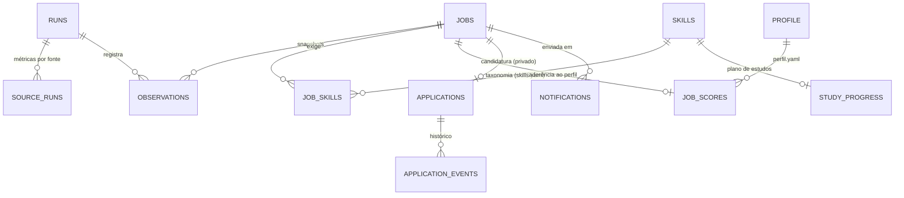

# Dicionário de dados

Lake = diretório do repositório privado `jobradar-data`. Todas as tabelas são Parquet com compressão zstd. Os timestamps estão em UTC. Os schemas físicos ficam em `src/jobradar/storage/schemas.py`.

## Modelo conceitual

## silver/jobs — uma linha por vaga (estado atual)

| Coluna | Tipo | Descrição |
|---|---|---|
| job_id | string | sha1(fonte, id na fonte), ou sha1(fonte, url canônica) quando a fonte não tem id |
| source / source_job_id | string | Fonte e identificador original |
| url | string | URL original, **com** todos os parâmetros, usada para a candidatura |
| url_canonica | string | URL sem fragmento e sem parâmetros de rastreamento, usada para deduplicar |
| titulo / titulo_norm | string | Título original / normalizado (minúsculas, sem acento) |
| empresa, cidade, uf, pais, local_raw | string | Localização: `uf` é sigla inferida (só no Brasil ou sem país identificado); `pais` e `local_raw` como vieram da fonte |
| pais_iso / regiao / cidade_norm | string | País ISO 3166-1 alfa-2 inferido; UF no Brasil ou estado/província normalizado nos demais países; cidade normalizada (ADR 0010) |
| geografia_versao | string | Versão das regras de geografia da linha. Nula ou diferente da atual = recalculada na próxima execução |
| modalidade | enum | remoto · hibrido · presencial · nao_informada |
| senioridade | enum | estagio · junior · pleno · senior · lideranca · nao_informada |
| familia | enum | engenharia_dados · analytics_engineering · desenvolvimento_dados · analise_dados · governanca_qualidade · administracao_dados · outra. Inferida pelo título (marcadores de gênero como "(a)" ignorados); título genérico com descrição de engenharia vira engenharia_dados |
| origem_campos | json | De onde veio cada campo inferido: `fonte`, `titulo`, `descricao`, `local_raw` ou `nao_informada` (país: também `cidade`, `uf` ou `multiplos`) |
| publicada_em | timestamp | Data de publicação informada pela fonte (pode ser nula) |
| prazo_em | timestamp | Prazo de inscrição, quando a fonte informa |
| primeira_observacao / ultima_observacao | timestamp | Primeira e última vez que o pipeline viu a vaga |
| ultima_execucao | string | run_id da última observação |
| status / motivo_status | enum / string | ativa · desconhecida · encerrada, com o motivo (ver architecture.md) |
| quadro | string | Quadro da empresa no ATS (token do Greenhouse, empresa no Lever, quadro do Ashby ou companyIdentifier do SmartRecruiters); nulo nas buscas (Gupy, Adzuna) |
| encerrada_em | timestamp | Primeira execução em que o quadro foi lido por completo sem a vaga; nulo se ela continua (ou voltou) no quadro |
| descricao / descricao_hash | string | Texto plano (máx. 20 mil caracteres; apagado após a retenção) / sha1 |
| chave_alternativa | string | sha1(empresa, título sem ruído, local), usada para deduplicar entre fontes. Local = UF no Brasil (ou vazio); `país:cidade` nos demais países |
| canonical_job_id / is_canonica | string / bool | Vaga eleita como representante do grupo de duplicatas (entre fontes ou republicação na mesma fonte) |
| atualizado_em | timestamp | Última escrita da linha |
| taxonomia_versao | string | Versão de `config/skills.yaml` com que as competências da vaga foram extraídas (nulo = 1.0.0). `jobradar reextrair` usa esta coluna |

## silver/job_skills

| Coluna | Descrição |
|---|---|
| job_id, skill_id | Vaga e competência (id em `config/skills.yaml`) |
| importancia | `requisito` ou `desejavel` (heurística de seções) |
| termo | Trecho normalizado que casou com o padrão |
| run_id | Execução (ou reextração) que extraiu |
| metodo | `termo` (nome ou sinônimo) ou `conceito` (frase que implica a competência). Nulo nas linhas da 1.0.0 = termo |
| evidencia | Frase **original** da vaga que justifica o achado (até 240 caracteres, recortada em volta do trecho). Apagada junto com a descrição pela retenção |
| confianca | `alta` (termo) ou `media` (conceito). Rótulo do método, não probabilidade: a precisão medida está no ADR 0001 |
| tipo | `tecnica`, `comportamental` ou `idioma`. Só `tecnica` alimenta gold, score, e-mail e dados públicos (nulo = técnica) |
| taxonomia_versao | Versão da taxonomia que gerou a linha |
| posicoes | JSON `[[frase, início, fim], ...]` com TODAS as menções da competência nas frases que contam (texto normalizado). Usado para a coocorrência não contar a mesma menção como par |

## silver/job_skills_semantica — camada de embeddings local (desligada por padrão)

Uma linha por achado semântico, só para competências que as regras **não** acharam na vaga. Uma vaga
processada sem achado tem uma linha com `skill_id` nulo (evita reprocessar). Só entra em gold, score e
dados públicos com `extracao.gold_hibrida: true`.

| Coluna | Descrição |
|---|---|
| job_id, skill_id, importancia, tipo | Como em `silver/job_skills` |
| evidencia | Frase da vaga mais parecida com as âncoras da competência |
| similaridade, limiar | Cosseno da frase com a melhor âncora e limiar usado para aceitar |
| confianca | `media` (similaridade ≥ `limiar_media`) ou `baixa` |
| modelo, modelo_revisao | Repositório e commit fixo do modelo (rastreabilidade) |
| taxonomia_versao, descricao_hash | Configuração e texto processados: mudou algum, a vaga volta a ficar pendente |
| run_id, calculado_em | Execução |

## silver/observations — uma linha por vaga por execução

`job_id`, `run_id`, `observada_em`, `descricao_hash`, `titulo`, `skills` (ids separados por vírgula), `mudou_requisitos`, `skills_adicionadas`, `skills_removidas`.

## silver/quality_issues

`run_id`, `source`, `source_job_id`, `campo`, `problema` (`invalido` ou `ausente`), `detalhe`, `registrado_em`.

## gold/skill_monthly — agregado incremental

| Coluna | Descrição |
|---|---|
| mes | AAAA-MM da **primeira observação** (fuso de São Paulo) |
| familia, senioridade | Recorte |
| skill_id | Competência, ou `__total__` para o denominador do grupo |
| vagas_com_skill / vagas_requisito | Vagas canônicas que citam a competência / que a citam como requisito |
| total_vagas | Total de vagas canônicas do grupo no mês |

Nas linhas `skill_id = "__total__"`, `vagas_com_competencia` é o número de vagas do grupo com ao menos
uma competência técnica: a base da coocorrência (nulo nas outras linhas).

## gold/skill_pairs — coocorrência, agregado incremental

| Coluna | Descrição |
|---|---|
| mes, familia, senioridade | Coorte (mês da primeira observação, fuso de São Paulo) e segmento, como em `skill_monthly` |
| skill_a, skill_b | Par de competências técnicas, sempre `skill_a < skill_b` |
| vagas_par | Vagas canônicas com as duas (mesma menção não conta; ver ADR 0002) |
| vagas_par_requisito | Vagas com as duas como requisito |

Recalculada nos mesmos meses que `skill_monthly`. As contagens podem ser somadas entre meses e segmentos;
as métricas (suporte, confiança, lift, Jaccard) são calculadas na leitura, em `analytics/coocorrencia.py`.

## gold/job_scores — uma linha por vaga e objetivo do perfil

Score de aderência explicável (0–100) e lacunas. `objetivo_id` = objetivo do perfil (Etapa 3); nulo em
linhas antigas, de quando o perfil tinha um objetivo só. Listas e e-mail usam a linha do melhor objetivo
de cada vaga (`scoring.melhor_por_vaga`); a análise por objetivo filtra `objetivo_id`.

`job_id`, `score` (0–100), `explicacao` (json com critério, pontos, máximo e detalhe), `lacunas` (json), `sem_evidencia` (json), `calculado_em`, `perfil_hash`.

## meta/runs e meta/source_runs

- **runs:** `run_id`, `iniciada_em`, `finalizada_em`, `status` (sucesso · parcial · falha), `duracao_s`, `metricas` (json completo do relatório).
- **source_runs:** `run_id`, `source`, `ok`, `coletados`, `validos`, `invalidos`, `duplicatas_fonte`, `novas`, `requisicoes`, `retentativas`, `erros`, `finalizada_em`.

## meta/board_runs — uma linha por quadro de ATS (empresa) e execução

`run_id`, `source` (`greenhouse` · `lever` · `ashby` · `smartrecruiters`), `quadro` (token/slug do catálogo), `ok`, `completo` (lido por
inteiro: serve de evidência para encerrar vagas), `vagas_listadas` (todas as do quadro), `vagas_mantidas`
(passaram no filtro de título e foram para a bronze), `requisicoes`, `retentativas`, `duracao_s`, `erro`
(mascarado), `finalizada_em`. Cruzada com `config/empresas.yaml` em `jobradar empresas listar` (ADR 0009).
Na bronze, o mesmo conteúdo fica em `por_quadro`.

## config/empresas.yaml — catálogo de empresas (versionado, público)

Uma entrada por empresa: `id`, `nome`, `pais` (ISO alfa-2), `segmento`, `site`, `pagina_carreiras`, `ats`,
`board`, `status` (`candidata` · `ativa` · `pausada` · `descartada`), `verificada_em`, `origem`
(`manual` · `descoberta`), `observacoes`. Só `ativa` é coletada. Regras no ADR 0009.

## meta/validacoes e private/validacoes

Uma linha por artefato validado em cada execução (docs/rastreabilidade.md): `run_id`, `artefato`
(`contrato_publico` · `taxonomia` · `catalogo_empresas` em meta; `perfil` · `radar_config` em private), `versao`, `ok`, `erros`
(quantidade), `detalhe` (curto e mascarado; para o perfil, só o campo, nunca o valor), `em`.

## meta/notifications

`job_id`, `canal` (`email`), `enviada_em`, `run_id`. É o que garante que a mesma vaga não seja enviada duas vezes.

## private/ — nunca publicado

| Tabela | Colunas |
|---|---|
| applications | job_id, status (nova · salva · revisar_curriculo · candidatado · entrevista · recusada · encerrada), atualizado_em, observacoes |
| application_events | job_id, de, para, em, nota |
| study_progress | skill_id, status (nao_iniciada · em_estudo · em_pratica · demonstrada_em_projeto · comprovada_profissional · pausada; os antigos planejado/em_andamento/concluido/pausado são convertidos), inicio, conclusao, evidencia, atualizado_em. Entra no **perfil efetivo** (ADR 0004) |
| study_events | skill_id, de, para, em, evidencia, nota — histórico de cada mudança de progresso |
| radar_envios | data (SP), objetivo_id, enviado_em, run_id, status (enviado · falha), assunto, vagas, acao_tipo, acao_skill, acao_texto, chaves (itens já apontados, contra repetição), erro — um registro por Radar diário |
| diagnosticos_mensais | mes, objetivo_id, gerado_em, run_id, status (gerado · enviado · falha), retrato (JSON: aderências, demanda, níveis, classes, prioritárias, projetos — só agregados e níveis), erro |
| relatorios_semanais | semana (ISO), objetivo_id, enviado_em, run_id, status, assunto, oportunidades (as 3, JSON), resumo (métricas para comparar com a semana seguinte), erro |
| radar.yaml | Configuração privada do Radar e do Relatório Semanal (seção `semanal`; modelo: `config/radar.example.yaml`) |
| curriculo_resumos_historico.json | Opcional, por adesão: um resumo de níveis por versão do currículo (comparação de versões no relatório semanal) |
| curriculo_resumo.json | **Opcional, por adesão**: só `{competência: nível}` do currículo, para o Radar no CI. Sem texto. `jobradar curriculo remover-resumo` apaga |
| profile.yaml | Perfil profissional (ver `config/profile.example.yaml`) |
| validacoes | run_id, artefato (perfil · radar_config), versao, ok, erros, detalhe, em — ver meta/validacoes |

**Fora do lake** (só na sua máquina, em `$JOBRADAR_HOME`, padrão `~/.jobradar`, nunca no git):
`curriculo/versoes/*.json` (versões estruturadas do currículo, com o texto extraído),
`curriculo/diagnosticos/*.json` (histórico de diagnósticos e sugestões por objetivo),
`evolucao/*.json` (planos de evolução salvos) e, só se você pedir,
`curriculo/originais/`. Ver docs/adr/0003-curriculo-privado.md.

`avaliacao/conjunto_ouro.yaml` (privado) guarda o conjunto-ouro da extração: texto das vagas e
anotações. Ver docs/avaliacao.md.
