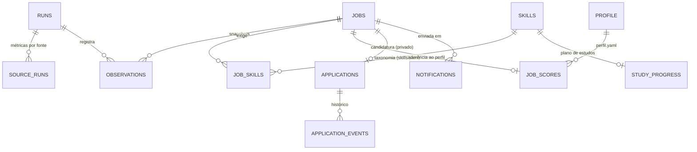

# Dicionário de dados

Lake = diretório do repositório privado `jobradar-data`. Todas as tabelas são Parquet com compressão zstd. Os timestamps estão em UTC. Os schemas físicos ficam em `src/jobradar/storage/schemas.py`.

## Modelo conceitual

## silver/jobs — uma linha por vaga (estado atual)

| Coluna | Tipo | Descrição |
|---|---|---|
| job_id | string | sha1(fonte, id na fonte), ou sha1(fonte, url canônica) quando a fonte não tem id |
| source / source_job_id | string | Fonte e identificador original |
| url | string | URL original, **com** todos os parâmetros, usada para a candidatura |
| url_canonica | string | URL sem fragmento e sem parâmetros de rastreamento, usada para deduplicar |
| titulo / titulo_norm | string | Título original / normalizado (minúsculas, sem acento) |
| empresa, cidade, uf, pais, local_raw | string | Localização: `uf` é sigla inferida; `local_raw` como veio da fonte |
| modalidade | enum | remoto · hibrido · presencial · nao_informada |
| senioridade | enum | estagio · junior · pleno · senior · lideranca · nao_informada |
| familia | enum | engenharia_dados · analytics_engineering · desenvolvimento_dados · analise_dados · governanca_qualidade · outra |
| origem_campos | json | De onde veio cada campo inferido: `fonte`, `titulo`, `descricao`, `local_raw` ou `nao_informada` |
| publicada_em | timestamp | Data de publicação informada pela fonte (pode ser nula) |
| prazo_em | timestamp | Prazo de inscrição, quando a fonte informa |
| primeira_observacao / ultima_observacao | timestamp | Primeira e última vez que o pipeline viu a vaga |
| ultima_execucao | string | run_id da última observação |
| status / motivo_status | enum / string | ativa · desconhecida · encerrada, com o motivo (ver architecture.md) |
| descricao / descricao_hash | string | Texto plano (máx. 20 mil caracteres; apagado após a retenção) / sha1 |
| chave_alternativa | string | sha1(empresa, título sem ruído, UF), usada para deduplicar entre fontes |
| canonical_job_id / is_canonica | string / bool | Vaga eleita como representante do grupo de duplicatas |
| atualizado_em | timestamp | Última escrita da linha |

## silver/job_skills

| Coluna | Descrição |
|---|---|
| job_id, skill_id | Vaga e competência (id em `config/skills.yaml`) |
| importancia | `requisito` ou `desejavel` (heurística de seções) |
| termo | Trecho do texto que casou com o padrão, como evidência da extração |
| run_id | Execução que extraiu |

## silver/observations — uma linha por vaga por execução

`job_id`, `run_id`, `observada_em`, `descricao_hash`, `titulo`, `skills` (ids separados por vírgula), `mudou_requisitos`, `skills_adicionadas`, `skills_removidas`.

## silver/quality_issues

`run_id`, `source`, `source_job_id`, `campo`, `problema` (`invalido` ou `ausente`), `detalhe`, `registrado_em`.

## gold/skill_monthly — agregado incremental

| Coluna | Descrição |
|---|---|
| mes | AAAA-MM da **primeira observação** (fuso de São Paulo) |
| familia, senioridade | Recorte |
| skill_id | Competência, ou `__total__` para o denominador do grupo |
| vagas_com_skill / vagas_requisito | Vagas canônicas que citam a competência / que a citam como requisito |
| total_vagas | Total de vagas canônicas do grupo no mês |

## gold/job_scores

`job_id`, `score` (0–100), `explicacao` (json com critério, pontos, máximo e detalhe), `lacunas` (json), `sem_evidencia` (json), `calculado_em`, `perfil_hash`.

## meta/runs e meta/source_runs

- **runs:** `run_id`, `iniciada_em`, `finalizada_em`, `status` (sucesso · parcial · falha), `duracao_s`, `metricas` (json completo do relatório).
- **source_runs:** `run_id`, `source`, `ok`, `coletados`, `validos`, `invalidos`, `duplicatas_fonte`, `novas`, `requisicoes`, `retentativas`, `erros`, `finalizada_em`.

## meta/notifications

`job_id`, `canal` (`email`), `enviada_em`, `run_id`. É o que garante que a mesma vaga não seja enviada duas vezes.

## private/ — nunca publicado

| Tabela | Colunas |
|---|---|
| applications | job_id, status (nova · salva · revisar_curriculo · candidatado · entrevista · recusada · encerrada), atualizado_em, observacoes |
| application_events | job_id, de, para, em, nota |
| study_progress | skill_id, status (planejado · em_andamento · concluido · pausado), inicio, conclusao, evidencia, atualizado_em |
| profile.yaml | Perfil profissional (ver `config/profile.example.yaml`) |
